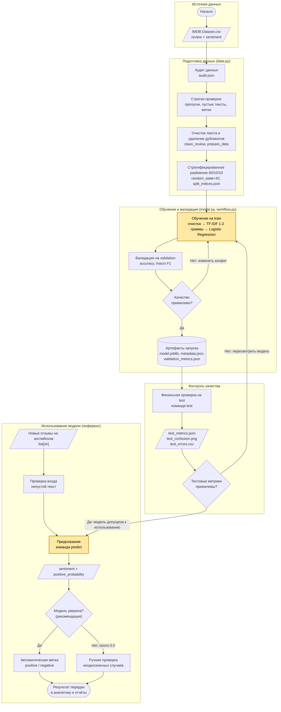

# Место модели в процессе проекта

Документ описывает, какую задачу решает ML-модель анализа тональности (`imdb-sentiment`), какие данные получает на вход и как её результат используется дальше. Подробное описание самой модели — в [`model_card.md`](model_card.md).

## 1. Схема процесса

Схема построена в формате Mermaid (отображается на GitHub автоматически). Блоки, связанные с моделью, выделены цветом.

## 2. Какую задачу в процессе решает модель

Модель автоматически определяет **тональность** англоязычного отзыва на фильм: `negative` (негативный) или `positive` (позитивный). Она заменяет ручное чтение и разметку отзывов и превращает неструктурированный текст в структурированный признак — метку и оценку вероятности положительного класса. Этот результат можно агрегировать, фильтровать и анализировать.

## 3. Почему для этой задачи целесообразно использовать ML

- **Нет простых формальных правил.** Тональность выражается лексикой, оборотами и контекстом; набор правил вида «если встречается слово X, то отзыв положительный» хрупкий и плохо обобщается (отрицания, смешанные оценки, разнообразие лексики).
- **Есть размеченные данные.** Датасет IMDB содержит порядка 50 000 отзывов со сбалансированными метками, этого достаточно для обучения с учителем.
- **Масштаб.** Ручная разметка тысяч отзывов дорога и медленна; модель обрабатывает их пакетно за секунды.
- **Простая и воспроизводимая модель.** TF-IDF с логистической регрессией быстро обучается, не требует GPU, интерпретируема (веса слов и биграмм) и служит надёжным baseline для сравнения с более сложными подходами.
- **Измеримое качество.** Результат проверяется метриками на отложенных выборках, чего нельзя сделать для ручных эвристик без отдельной разметки.

## 4. Какие данные поступают на вход модели

| Этап | Входные данные |
|---|---|
| Обучение | Таблица `IMDB Dataset.csv` (50 000 отзывов): `review` (текст), `sentiment` (метка positive/negative). После аудита, очистки и удаления 422 дубликатов остаётся 49 578 отзывов; выборка `train` — 39 662 (80 %) |
| Валидация | Выборка `validation` — 4 958 отзывов (10 %): тексты и метки |
| Финальный тест | Выборка `test` — 4 958 отзывов (10 %), восстанавливаемая тем же детерминированным разбиением; датасет проверяется по SHA-256 |
| Инференс | Один или несколько непустых англоязычных текстов (`list[str]`) |

Очистка текста (удаление HTML-тегов, раскрытие HTML-сущностей, нормализация пробелов) входит в сам пайплайн модели, поэтому на вход можно подавать «сырой» текст отзыва; это важно, так как 58 % исходных отзывов содержат HTML-разметку. Пустые тексты отклоняются с ошибкой.

## 5. Как результат работы модели используется дальше

1. **Выход модели:** для каждого текста возвращаются `sentiment` (`negative`/`positive`) и `positive_probability` (0…1).
2. **Автоматическое использование:** метка записывается в отчёты и аналитику (доля положительных и отрицательных отзывов, динамика, сравнение фильмов).
3. **Контроль неоднозначных случаев:** тексты с вероятностью около 0.5 рекомендуется направлять на ручную проверку, так как модель хуже справляется с сарказмом и смешанными оценками. Это рекомендация к применению; в коде проекта такой порог не реализован.
4. **Результат контроля качества:** на тестовой выборке модель показала accuracy 0.9074 и macro F1 0.9074 (на валидации — 0.9040 и 0.9040), то есть качество стабильно и достаточно для использования в роли baseline. Подробности — в [`model_card.md`](model_card.md).
5. **Контроль качества и развитие модели:** метрики (`validation_metrics.json`, `test_metrics.json`), матрица ошибок и `test_errors.csv` используются для анализа ошибок. По их итогам меняются конфигурация, признаки или алгоритм, после чего обучение повторяется; каждый запуск сохраняется в отдельном версионированном артефакте.

## 6. Пример работы модели

| Входной текст | Результат | positive_probability |
|---|---|---|
| A wonderful movie with excellent acting. | positive | 0.9593 |
| A boring movie and a complete waste of time. | negative | 0.0094 |

## 7. Связанные файлы репозитория

| Файл / каталог | Роль |
|---|---|
| `src/imdb_sentiment/data.py` | Загрузка, аудит, очистка, проверка, дедупликация и разбиение данных |
| `src/imdb_sentiment/model.py` | Построение `Pipeline` (очистка → TF-IDF → логистическая регрессия) |
| `src/imdb_sentiment/workflow.py` | Обучение, оценка, сохранение и загрузка артефактов, инференс |
| `src/imdb_sentiment/cli.py` | Команды `train`, `test`, `predict` |
| `configs/default.toml` | Параметры разбиения и модели |
| [`model_card.md`](model_card.md) | Подробная карточка модели |
