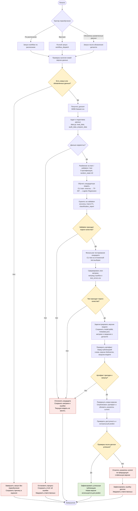

# Процесс автоматического переобучения модели

## 1. Назначение процесса

Документ описывает предлагаемый процесс автоматического переобучения модели `imdb-sentiment`: от запуска по триггеру до публикации новой версии модели.

В проекте используется бинарный классификатор тональности англоязычных отзывов на фильмы. Модель представляет собой `sklearn Pipeline`: очистка текста → TF-IDF (униграммы и биграммы) → Logistic Regression.

Текущая реализация уже содержит команды `train`, `test` и `predict`, проверку данных, расчёт метрик и сохранение версионированных артефактов. Автоматический запуск переобучения, реестр моделей и развёртывание пока не реализованы. Ниже описан целевой процесс, который можно автоматизировать, например, с помощью GitHub Actions и существующего CLI проекта.

## 2. Схема процесса



## 3. Описание этапов

| Этап | Что происходит | Результат, передаваемый дальше |
|---|---|---|
| 1. Триггер | Переобучение запускается по расписанию, вручную через `workflow_dispatch` или после обновления размеченного датасета. Для учебного проекта расписание является периодической проверкой, а не гарантией появления новых данных. | Запущенный workflow с причиной запуска. |
| 2. Проверка обновления данных | Процесс проверяет, появилась ли новая версия датасета или изменился ли его SHA-256. Если изменений нет, запуск завершается без обучения. | Подтверждение наличия новых данных либо запись о пропуске переобучения. |
| 3. Получение данных | Загружается актуальный `IMDB Dataset.csv` с полями `review` и `sentiment`. Источник должен быть доверенным, а версия датасета фиксируется для воспроизводимости. | Файл датасета и его SHA-256. |
| 4. Аудит и подготовка | Используются функции из `data.py`: проверка структуры, пропусков, пустых отзывов и меток; очистка HTML и пробелов; поиск дубликатов. Противоречивые метки у одинаковых текстов, пустые данные и недопустимые классы приводят к ошибке. | Проверенный набор уникальных отзывов с двумя классами `negative` и `positive`; отчёт `audit.json`. |
| 5. Разбиение данных | Данные разделяются на `train`, `validation` и `test` в пропорции 80/10/10. Разбиение стратифицированное, с `random_state=42`, после удаления дубликатов. | Три непересекающиеся выборки и `split_indices.json`. |
| 6. Обучение кандидата | На `train` обучается новая версия Pipeline: очистка текста, TF-IDF с униграммами и биграммами, Logistic Regression. Предупреждение `ConvergenceWarning` считается ошибкой. Для каждого запуска создаётся отдельный каталог артефактов. | Кандидатная модель `model.joblib` и `metadata.json` с конфигурацией, хэшем датасета и версиями библиотек. |
| 7. Проверка validation | Кандидат оценивается на validation, которая не участвовала в обучении. Рассчитываются Accuracy, Macro F1 и метрики по классам. Результаты сохраняются в `validation_metrics.json`; также формируются матрица ошибок и список ошибочных предсказаний. | Метрики validation и решение о допуске к финальному тесту. |
| 8. Финальный тест | Если validation прошла пороги, запускается отдельная команда `test`. Она проверяет совпадение SHA-256 датасета с сохранённым в метаданных и оценивает модель на отложенной test-выборке. Test не используется для подбора параметров. | `test_metrics.json`, `test_confusion.png`, `test_errors.csv` и итоговые тестовые метрики. |
| 9. Решение о публикации | Метрики validation и test сравниваются с установленными порогами качества. Кандидат публикуется только при успешном прохождении обеих проверок. Дополнительно можно проверять отсутствие существенного ухудшения относительно текущей версии на общей контрольной выборке. | Одобрение кандидата либо отказ в публикации. |
| 10. Регистрация версии | Успешный кандидат сохраняется как отдельная неизменяемая версия. Вместе с моделью сохраняются метаданные, хэш датасета, конфигурация, версии библиотек, метрики и отчёты. | Зарегистрированный артефакт с уникальным идентификатором запуска/версии. |
| 11. Проверка артефакта | Перед публикацией проверяются наличие файлов, схема артефакта и совместимость версии scikit-learn. Модель загружается из доверенного источника, после чего выполняется контрольное предсказание на примерах. | Артефакт, готовый к развёртыванию, либо ошибка проверки. |
| 12. Деплой | Новая версия публикуется как доступный артефакт. Указатель `current` переключается на неё только после успешных проверок. Предыдущая стабильная версия сохраняется для отката. | Новая версия становится используемой для команды `predict`. |
| 13. Проверка после деплоя | Выполняется контрольная загрузка опубликованной модели и тестовый вызов предсказания. Проверяется, что модель отвечает и возвращает ожидаемые поля `sentiment` и `positive_probability`. | Подтверждение успешного деплоя либо сигнал к откату. |
| 14. Откат и обработка ошибок | При ошибке подготовки данных, обучении, проверке качества или деплое кандидат отклоняется. При сбое после переключения `current` указатель возвращается на предыдущую стабильную версию. Ошибка и метрики сохраняются в журнале, ответственные получают уведомление. | Работающая предыдущая версия модели и диагностическая информация. |

## 4. Условия допуска новой модели к эксплуатации

Для принятия решения используются две независимые проверки.

**Проверка на validation:**
- `accuracy` не ниже установленного минимального порога;
- `macro_f1` не ниже установленного минимального порога;
- отсутствуют ошибки обучения, включая `ConvergenceWarning`;
- обе целевые метки представлены в оценочной выборке.

**Финальная проверка на test:**
- `accuracy` и `macro_f1` также не ниже установленных порогов;
- проверка выполняется на отложенной выборке, которая не использовалась при обучении и подборе параметров;
- SHA-256 датасета совпадает с хэшем, записанным в метаданных модели.

В качестве начального ориентира можно использовать порог `0.90` для Accuracy и Macro F1. Он близок к результатам текущей модели: validation Accuracy и Macro F1 составляют `0.9040`, test Accuracy и Macro F1 составляют `0.9074`. Пороги должны храниться в конфигурации процесса и при необходимости пересматриваться осознанно, а не подгоняться под результаты конкретного запуска.

Если хотя бы одна обязательная проверка не пройдена, новая версия не публикуется. Текущая стабильная модель продолжает использоваться.

## 5. Версионирование и хранение артефактов

Для каждого запуска обучения создаётся отдельный каталог, например:

```text
artifacts/
├── run-001/
│   ├── model.joblib
│   ├── metadata.json
│   ├── audit.json
│   ├── split_indices.json
│   └── validation_metrics.json
├── run-002/
│   ├── model.joblib
│   ├── metadata.json
│   ├── audit.json
│   ├── split_indices.json
│   └── validation_metrics.json
├── test-002/
│   ├── test_metrics.json
│   ├── test_confusion.png
│   └── test_errors.csv
└── current
```

`run-001`, `run-002` и последующие каталоги не перезаписывают друг друга. Указатель `current` обозначает версию, допущенную к эксплуатации. Он обновляется только после прохождения всех проверок. Предыдущая стабильная версия сохраняется, чтобы при необходимости можно было выполнить откат.

В `metadata.json` уже предусмотрены важные для воспроизводимости сведения: SHA-256 датасета, конфигурация, размеры выборок, версии Python и библиотек, время создания артефакта.

## 6. Обработка неуспешных сценариев

- **Новых данных нет.** Переобучение пропускается, действующая модель остаётся без изменений.
- **Ошибка или некорректная разметка в данных.** Процесс останавливается на этапе подготовки, сохраняется отчёт аудита.
- **Ошибка обучения.** Кандидат не регистрируется как рабочая версия; сохраняется журнал ошибки.
- **Не пройдена validation или test.** Кандидат отклоняется, предыдущая версия продолжает работать.
- **Повреждён или несовместим артефакт.** Публикация запрещается.
- **Ошибка после деплоя.** Указатель `current` возвращается на предыдущую стабильную версию, инцидент фиксируется.

Во всех случаях неуспешного запуска важно сохранить диагностические данные, чтобы можно было понять причину сбоя и повторить процесс после её устранения.

## 7. Связь с текущей реализацией проекта

| Существующий компонент | Использование в процессе переобучения |
|---|---|
| `src/imdb_sentiment/data.py` | Загрузка, аудит, очистка, проверка, удаление дубликатов и разбиение данных. |
| `src/imdb_sentiment/model.py` | Построение Pipeline с TF-IDF и Logistic Regression. |
| `src/imdb_sentiment/workflow.py` | Обучение, оценка, сохранение артефакта, проверка совместимости и предсказание. |
| `src/imdb_sentiment/cli.py` | Запуск команд `train`, `test` и `predict` из автоматизированного workflow. |
| `configs/default.toml` | Параметры разбиения и модели. |
| `.github/workflows/ci.yml` | Уже выполняет проверки кода, зависимостей и сборки при `push` и `pull_request`. Может быть дополнен отдельным workflow переобучения. |
| `artifacts/` | Хранение отдельных версий моделей и результатов оценки. |

Для реализации описанного процесса потребуется добавить отдельный workflow автоматизации (например, `.github/workflows/retrain.yml`), настроить расписание и ручной запуск, определить источник обновлённых размеченных данных, пороги качества и способ публикации артефактов. Также потребуется реализовать переключение версии `current`, проверку после деплоя и откат. Эти возможности являются предложением для дальнейшего развития проекта, а не частью текущего кода.

## 8. Итог

Таким образом, новая модель попадает в эксплуатацию не сразу после обучения, а только после последовательной проверки качества на validation и test, проверки целостности и совместимости артефакта и успешного контрольного запуска после публикации. Если любой обязательный этап завершается ошибкой, кандидат отклоняется, а текущая стабильная версия продолжает использоваться. Это позволяет обновлять модель контролируемо, сохранять воспроизводимость экспериментов и иметь возможность быстрого отката.
